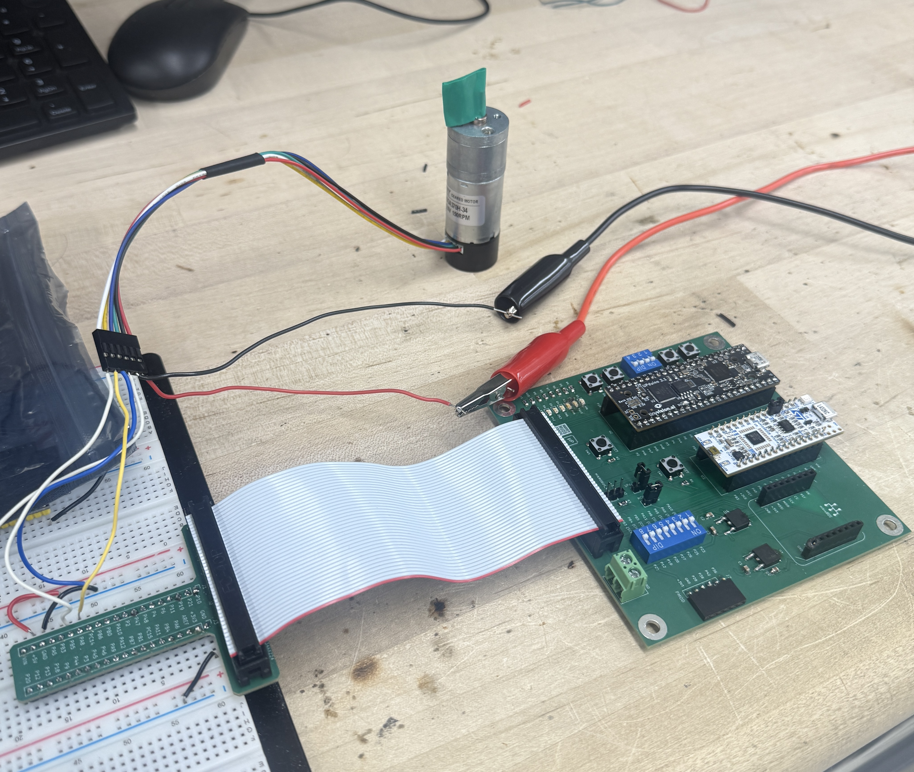
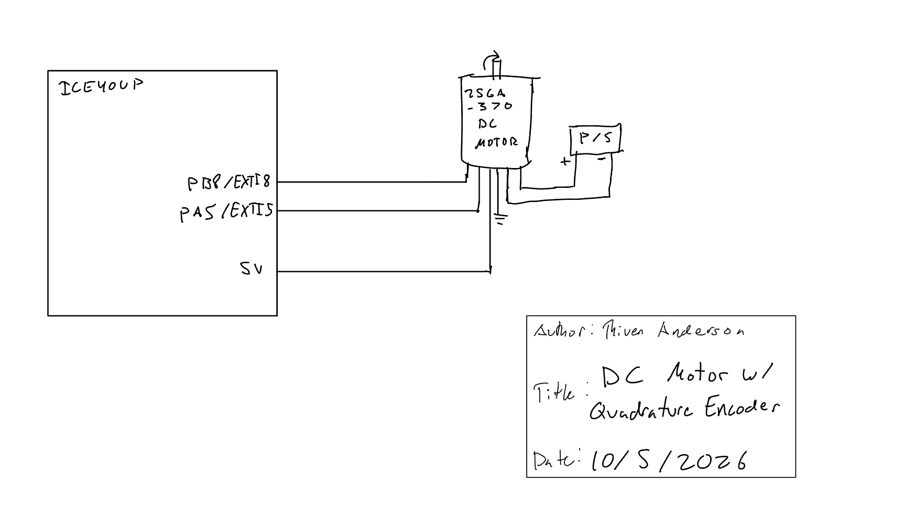

## Introduction

Lab 5 uses interrupts on the STM32L432KC to measure the direction and angular velocity of a DC motor from its quadrature encoder. Both edges of both encoder channels are used to update a signed encoder count. TIM6 provides the time base for converting changes in count into velocity, while TIM7 controls how often the result is printed.

The complete source code is available in the [Lab 5 GitHub repository](https://github.com/thivenanderson/E155-Lab5). The design follows the current [Lab 5 specifications](https://hmc-e155.github.io/lab/lab5/specs.html).

## Hardware

The encoder channels are connected to PA8 and PB5. Both pins are listed as 5 V tolerant in the STM32L432KC datasheet, allowing them to safely receive the 5 V encoder outputs.

| Signal | MCU pin |
|---|---|
| Encoder A | PA8 |
| Encoder B | PB5 |
| Encoder power | 5 V |
| Encoder ground | GND |

The calculations below use the 408 pulses/output-revolution value for the `-34` motor.

{width=50%}

## Software and Microcontroller Design

### Interrupt-Based Quadrature Decoder

PA8 and PB5 are configured as GPIO inputs and routed to EXTI8 and EXTI5. Interrupts are enabled on both rising and falling edges of both channels. The shared `EXTI9_5_IRQHandler()` reads the current two-bit encoder state and compares it with the previous state.

One valid state sequence increments the signed count,

```text
00 -> 10 -> 11 -> 01 -> 00
```

while the reverse sequence decrements it,

```text
00 -> 01 -> 11 -> 10 -> 00
```

For the final wiring, positive velocity corresponds to clockwise rotation and negative velocity corresponds to counterclockwise rotation.

<details>
<summary>Quadrature count update</summary>

```c
if ((previous_state == 0b00 && current_state == 0b10) ||
    (previous_state == 0b10 && current_state == 0b11) ||
    (previous_state == 0b11 && current_state == 0b01) ||
    (previous_state == 0b01 && current_state == 0b00)) {
    encoder_count++;
}
else if ((previous_state == 0b00 && current_state == 0b01) ||
         (previous_state == 0b01 && current_state == 0b11) ||
         (previous_state == 0b11 && current_state == 0b10) ||
         (previous_state == 0b10 && current_state == 0b00)) {
    encoder_count--;
}
```

</details>

### Velocity Calculation

The encoder produces 12 pulses per motor revolution. For a 34:1 gearbox this gives

$$
12(34)=408
$$

pulses per output-shaft revolution. Because both edges of both encoder channels are used, the software count is

$$
N_{rev}=4(408)=1632\text{ counts/rev}.
$$

TIM6 is configured as a free-running timer with a 1 ms count period. Velocity is calculated from the change in signed encoder count:

$$
v=\frac{\Delta N}{1632\left(\Delta t_{ms}/1000\right)}
$$

where the sign of $v$ gives direction.

The function allows an update after at least 100 ms. In the current main loop it is called once every 250 ms, so the displayed velocity updates at approximately 4 Hz, above the required 1 Hz. At a 250 ms measurement interval, one encoder count corresponds to approximately

$$
\frac{1}{1632(0.25)}
\approx 0.00245\text{ rev/s}.
$$

### Program Flow

```{mermaid}
flowchart TD
    A[Start] --> B[encoderInit]
    B --> C[Configure PA8 and PB5]
    C --> D[Configure EXTI on both edges]
    D --> E[Start free-running TIM6]
    E --> F[Main loop]
    F --> G[Read signed encoder count]
    G --> H[Calculate velocity from count change and TIM6]
    H --> I[Print direction and rev/s]
    I --> J[TIM7 250 ms delay]
    J --> F

    K[Encoder A or B edge] --> L[EXTI9_5_IRQHandler]
    L --> M[Read current A/B state]
    M --> N[Compare previous and current state]
    N --> O[Increment or decrement encoder_count]
    O --> P[Save current state]

    O -. shared encoder_count .-> G
```

## Testing and Results

A manual one-revolution test produced approximately 1672 signed counts. The theoretical value is 1632 counts/rev, giving a difference of approximately

$$
\frac{|1672-1632|}{1632}(100)\approx2.45\%.
$$

The difference is consistent with the limited accuracy of manually marking and rotating exactly one revolution.

At 12 V, the motor produced a stable measured speed of approximately **2.9 rev/s**. At the lowest tested voltage where the motor continued to rotate, approximately **0.4 V**, the measured speed remained nonzero at approximately **0.05--0.07 rev/s**.


## Interrupts Compared with Polling

At the maximum tested speed of approximately 2.9 rev/s at 12 V, the encoder produces

$$
2.9(1632)=4733\text{ encoder edges/s}.
$$

This corresponds to one encoder transition approximately every

$$
\frac{1}{4733}\approx211\ \mu\text{s}.
$$

A polling implementation would therefore need to read both encoder channels faster than about 4.7 kHz, and preferably substantially faster, to avoid missing transitions. This polling would need to run continuously even when the motor is stopped.

The interrupt-based implementation instead allows the main loop to run independently while EXTI responds whenever an encoder edge occurs. At 2.9 rev/s, the MCU handles approximately 4733 encoder interrupts per second while still allowing the main loop to update and print velocity every 250 ms. This makes interrupts better suited for detecting short encoder transitions without requiring the main loop to continuously poll the GPIO pins.


## Schematic

The schematic shows only the off-board motor/encoder connections, including 5 V, ground, encoder A to PA8, encoder B to PB5, and the motor supply connections. Components already present on the E155 development board should not be redrawn; see the [E155 development board schematic](https://hmc-e155.github.io/assets/doc/E155%20FA22%20Development%20Board%20Schematic.pdf).

{width=50%}

## Requirements Verification

The system uses EXTI interrupts rather than polling to detect encoder transitions and uses both edges of both channels. Direction is determined from the quadrature state sequence, and velocity is displayed in rev/s at approximately 4 Hz. PA8 and PB5 are 5 V-tolerant inputs. Testing showed stable operation around 2.9--3.0 rev/s at 12 V and a nonzero reading around 0.05--0.07 rev/s at the lowest tested motor speed.

<!-- TODO: After final stopped test and schematic are complete, change this paragraph to explicitly state that all proficiency/excellence requirements were met, or list any remaining shortcoming. -->

## AI Prototype and Reflection
**TODO**

<!-- TODO: Add a small screenshot or short transcript/code example from the AI prototype if desired for documentation. -->

## Time Spent

Total time spent on Lab 5: **15**

