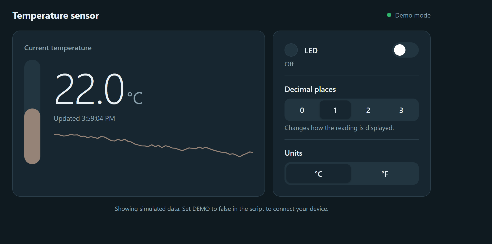

## Introduction

Lab 6 uses the STM32L432KC to read a DS1722 temperature sensor over SPI and communicate with an ESP8266 over UART. The ESP8266 hosts a webpage that displays temperature and LED status, turns the LED on or off, and allows the user to select the temperature resolution.

The code is available in the [Lab 6 GitHub repository](https://github.com/thivenanderson/E155-Lab6), and the design follows the [Lab 6 specifications](https://hmc-e155.github.io/lab/lab6/specs.html).

## Hardware

The DS1722 is powered at 3.3 V, with SERMODE connected HIGH to select SPI. The ESP8266 Click module plugs into the development board's mikroBUS socket and communicates with the STM32 through USART1 at 125000 baud. The FPGA DIP switches were opened to avoid conflicts with the MCU pins.

| DS1722 pin | Signal | Connection |
|---|---|---|
| 1, 8 | VDDD, VDDA | 3.3 V |
| 2 | CE | PB0 |
| 3 | SCLK | PA5 |
| 4 | GND | GND |
| 5 | SDO | PA6 (MISO) |
| 6 | SDI | PB5 (MOSI) |
| 7 | SERMODE | 3.3 V |

The STM32's on-board LED is controlled through PB3.


## Software and Microcontroller Design

The SPI library uses the CMSIS register definitions to configure SPI1 as a master, with 8-bit data transfers. The selected settings are `initSPI(4, 0, 1)`: a divide-by-32 prescaler, idle-low clock, and sampling on the second clock edge (SPI Mode 1). With an 80 MHz SPI peripheral clock, the expected SPI clock is 2.5 MHz.

The DS1722 driver uses PB0 to control CE. It writes to the configuration register to enable continuous conversions and set the resolution from 8 to 12 bits. The initial configuration is 12-bit. For a temperature read, it transmits address `0x01`, then reads the LSB and MSB in a three-byte burst. The bytes are combined as a signed 16-bit value and divided by 256 to obtain degrees Celsius. This also handles negative temperatures.

<details>
<summary>SPI transfer function</summary>

```c
char spiSendReceive(char send) {
    while (!(SPI1->SR & SPI_SR_TXE));
    *(__IO uint8_t *)&SPI1->DR = (uint8_t)send;

    while (!(SPI1->SR & SPI_SR_RXNE));
    return *(__IO uint8_t *)&SPI1->DR;
}
```

</details>

The STM32 waits for UART requests from the ESP8266, updates the LED or resolution if requested, reads the latest temperature, and sends back the HTML webpage. Temperature formatting uses integer hundredths because the default embedded `sprintf()` library did not correctly display floating-point format specifiers.


## SPI Oscilloscope Verification

SPI communication was verified using a four-channel oscilloscope rather than a logic analyzer. The DS1722 configuration register was successfully read back as `0xE8`, confirming 12-bit continuous conversion. The sensor initially measured approximately 22°C, and the reading increased when the sensor was warmed by hand.

The annotated oscilloscope capture below shows a complete temperature read. CH1 (yellow) is MISO, CH2 (green) is MOSI, CH3 (blue) is SCK, and CH4 (pink) is CE. CE remains HIGH throughout the three-byte transfer, with 24 total clock pulses. The STM32 sends `0x01 0x00 0x00`, and the sensor returns `0x40` (LSB) and `0x16` (MSB), corresponding to:

$$
T = \frac{\texttt{0x1640}}{256} = 22.25^\circ\text{C}
$$

{width=100%}

### SPI Timing

The clock uses CPOL = 0 and CPHA = 1, meaning SCK idles LOW and data is sampled on the falling edge. With an 80 MHz peripheral clock and a prescaler of 32, the SPI frequency is 2.5 MHz.

$$
T_{SCK}=\frac{1}{2.5\text{ MHz}}=400\text{ ns}
$$

The expected HIGH and LOW times are each approximately 200 ns, exceeding the DS1722 minimum of 100 ns. The SPI frequency is also below the maximum of 5 MHz.

The oscilloscope shows CE rising before the first clock pulse and remaining HIGH throughout the transaction. The datasheet requires a minimum CE setup time of 400 ns. The capture is consistent with this timing, although an exact cursor measurement was not taken.


## Webpage Verification

The ESP8266 hosted the webpage over its Wi-Fi network. The page displayed the measured temperature and current LED state. Refreshing the page updated the temperature, and the LED and 8–12-bit resolution controls were tested. The firmware writes the new resolution setting to the DS1722 configuration register when a button is selected.

<details>
<summary>Working Lab 6 webpage</summary>


{width=75%}


</details>

## Schematic

The final schematic should show the off-board DS1722 circuit and connections to the MCU, including both 3.3 V supplies, SERMODE, ground, and the four SPI connections. The ESP8266 uses the development board's existing mikroBUS socket. Components already present on the development board are not redrawn; see the [E155 development board schematic](https://hmc-e155.github.io/assets/doc/E155%20FA22%20Development%20Board%20Schematic.pdf).


{width=85%}


## Requirements Verification

The design successfully reads temperature over SPI, serves the webpage over UART/Wi-Fi, controls the on-board LED, and offers 8–12-bit resolution settings. The driver uses CMSIS SPI registers, and the signed temperature conversion supports the required -10°C to 30°C range. The configuration readback, observed temperature response, and SPI waveform support the functionality of the hardware.


## AI Prototype and Reflection

For the AI prototype, I used Claude to generate a web interface for monitoring temperature readings from the DS1722 sensor and controlling an LED. The generated HTML page included a live temperature display, trend graph, adjustable decimal precision, and an LED toggle. The initial prototype used simulated sensor data, with API endpoints defined for future communication with the microcontroller. The page was generated very quickly, but I was not the biggest fan of the layout, and I noticed that classmates who used similar prompts received nearly identical pages.

I also asked Claude to generate a CMSIS-based SPI driver for the STM32L432KC. Its initial response assumed different pin assignments than my wiring. After I provided the correct pins (PA5 SCK, PA6 MISO, PB5 MOSI, and PB0 CE) and asked it to integrate the driver into a `main.c` program, the code worked on the hardware and retrieved temperature readings.

One limitation was that Claude did not automatically organize the code into reusable `.c` and `.h` libraries; that would need to be requested separately. Even though the generated driver worked, the code still needs to be fully inspected, particularly the pin assignments, peripheral configuration, SPI timing, and datasheet requirements. It was useful for quickly getting a working prototype, but I would not use the generated code without reviewing it.

<details>
<summary>AI-generated webpage</summary>

{width=75%}
</details>


<details>

<summary>AI-generated DS1722 SPI driver (corrected pin assignments)</summary>

```c
/*
 * DS1722 temperature sensor driver
 * Target: STM32L432KC, CMSIS register access only (no HAL)
 *
 * Pin mapping (SPI1, AF5):
 *   PA5 = SCK
 *   PA6 = MISO  (connects to DS1722 SDO)
 *   PB5 = MOSI  (connects to DS1722 SDI)
 *   PB0 = CE    (GPIO, active HIGH)
 */

#include "stm32l4xx.h"
#include <stdint.h>

/* ---- DS1722 registers (SPI addresses) ---- */
#define DS1722_REG_CFG_READ   0x00
#define DS1722_REG_TEMP_LSB   0x01   /* MSB is at 0x02; burst reads auto-increment */
#define DS1722_REG_CFG_WRITE  0x80

/* Config register: 1 1 1 1SHOT R2 R1 R0 SD */
#define DS1722_CFG_BASE       0xE0
#define DS1722_CFG_RES(bits)  ((uint8_t)(((bits) - 8) << 1))   /* 8..12 bits */

/* CE is active HIGH on the DS1722 */
#define DS1722_CE_HIGH()  (GPIOB->BSRR = GPIO_BSRR_BS0)
#define DS1722_CE_LOW()   (GPIOB->BSRR = GPIO_BSRR_BR0)

/* Exchange one byte. Byte-wide DR access is required on the L4 so the
   FIFO doesn't pack/expect 16-bit frames. */
static uint8_t spi1_xfer(uint8_t tx)
{
    while (!(SPI1->SR & SPI_SR_TXE)) { }
    *(volatile uint8_t *)&SPI1->DR = tx;
    while (!(SPI1->SR & SPI_SR_RXNE)) { }
    return *(volatile uint8_t *)&SPI1->DR;
}
[

void ds1722_init(uint8_t resolution_bits)
{
    /* Clocks */
    RCC->AHB2ENR |= RCC_AHB2ENR_GPIOAEN | RCC_AHB2ENR_GPIOBEN;
    RCC->APB2ENR |= RCC_APB2ENR_SPI1EN;

    /* PA5 (SCK) and PA6 (MISO) -> alternate function 5 */
    GPIOA->MODER &= ~(GPIO_MODER_MODE5 | GPIO_MODER_MODE6);
    GPIOA->MODER |=  (GPIO_MODER_MODE5_1 | GPIO_MODER_MODE6_1);
    GPIOA->AFR[0] &= ~((0xFUL << 20) | (0xFUL << 24));
    GPIOA->AFR[0] |=  ((5UL << 20) | (5UL << 24));

    /* PB5 (MOSI) -> alternate function 5 */
    GPIOB->MODER &= ~GPIO_MODER_MODE5;
    GPIOB->MODER |=  GPIO_MODER_MODE5_1;
    GPIOB->AFR[0] &= ~(0xFUL << 20);
    GPIOB->AFR[0] |=  (5UL << 20);

    /* PB0 -> push-pull output for CE, idle low */
    GPIOB->MODER &= ~GPIO_MODER_MODE0;
    GPIOB->MODER |=  GPIO_MODER_MODE0_0;
    DS1722_CE_LOW();

    /* SPI1: master, software NSS, mode 1 (CPOL=0, CPHA=1), MSB first,
       fPCLK/4 (1 MHz at the default 4 MHz MSI; DS1722 max is 2 MHz) */
    SPI1->CR1 = SPI_CR1_MSTR | SPI_CR1_SSM | SPI_CR1_SSI |
                SPI_CR1_CPHA | (1U << SPI_CR1_BR_Pos);
    SPI1->CR2 = (7U << SPI_CR2_DS_Pos) | SPI_CR2_FRXTH;   /* 8-bit frames */
    SPI1->CR1 |= SPI_CR1_SPE;

    /* Write config: continuous conversion (SD = 0), chosen resolution */
    DS1722_CE_HIGH();
    spi1_xfer(DS1722_REG_CFG_WRITE);
    spi1_xfer(DS1722_CFG_BASE | DS1722_CFG_RES(resolution_bits));
    while (SPI1->SR & SPI_SR_BSY) { }
    DS1722_CE_LOW();
}

/* Returns temperature as signed fixed-point, 8 fractional bits
   (degrees C = raw / 256.0). Resolution is 1/16 degC at 12 bits. */
int16_t ds1722_read_raw(void)
{
    DS1722_CE_HIGH();
    spi1_xfer(DS1722_REG_TEMP_LSB);          /* address phase */
    uint8_t lsb = spi1_xfer(0xFF);           /* 0x01: fractional bits in [7:4] */
    uint8_t msb = spi1_xfer(0xFF);           /* 0x02: signed integer part */
    while (SPI1->SR & SPI_SR_BSY) { }
    DS1722_CE_LOW();

    return (int16_t)(((uint16_t)msb << 8) | lsb);
}
{width=75%}

float ds1722_read_celsius(void)
{
    return (float)ds1722_read_raw() / 256.0f;
}
{width=75%}

/* Example usage:
 *
 *   ds1722_init(12);          // 12-bit resolution
 *   // wait ~1.2 s for the first conversion
 *   float t = ds1722_read_celsius();
 */
```

</details>

## Time Spent

Total time spent on Lab 6: **12**
