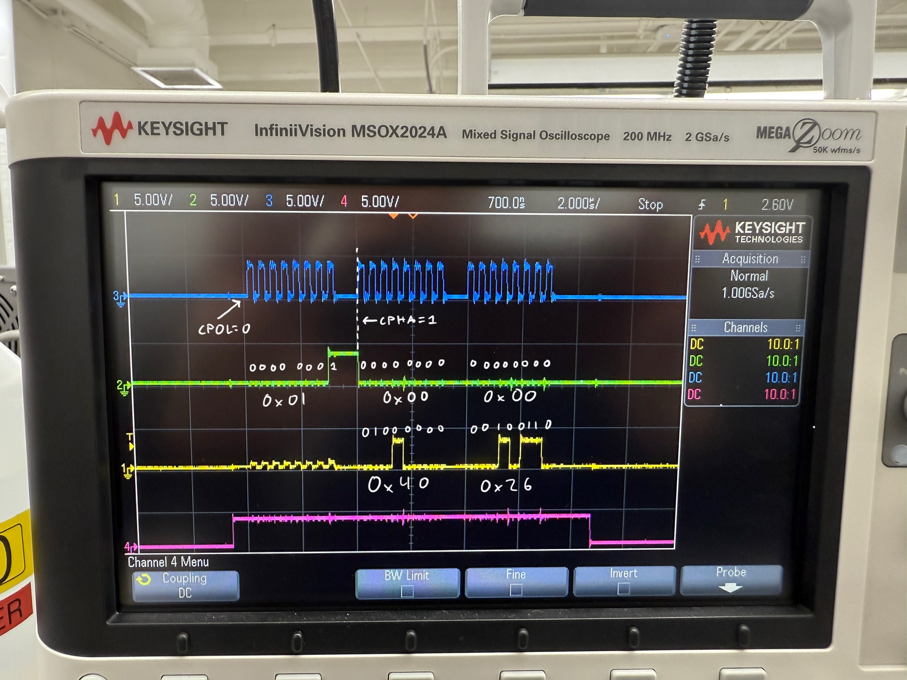
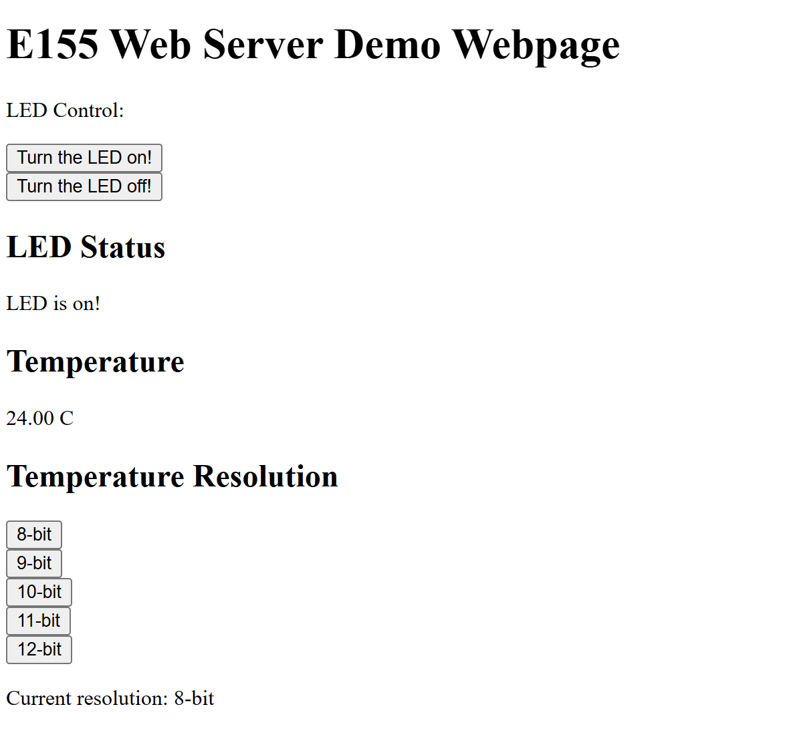
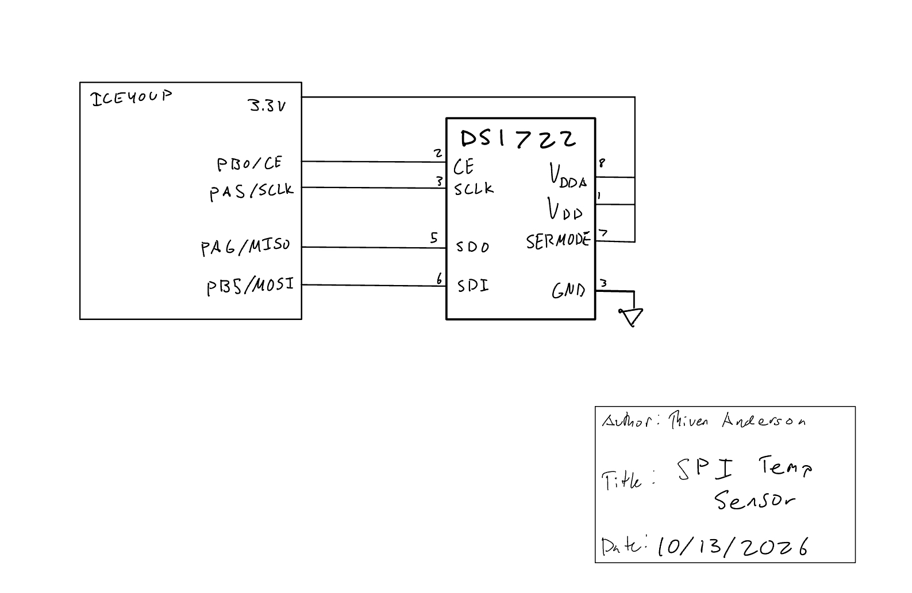

## Introduction

Lab 6 uses the STM32L432KC to read a DS1722 temperature sensor over SPI and communicate with an ESP8266 over UART. The ESP8266 hosts a webpage that displays temperature and LED status, turns the LED on or off, and allows the user to select the temperature resolution.

The code is available in the [Lab 6 GitHub repository](https://github.com/thivenanderson/E155-Lab6), and the design follows the [Lab 6 specifications](https://hmc-e155.github.io/lab/lab6/specs.html).

## Hardware

The DS1722 is powered at 3.3 V, with SERMODE connected HIGH to select SPI. The ESP8266 Click module plugs into the development board's mikroBUS socket and communicates with the STM32 through USART1 at 125000 baud. The FPGA DIP switches were opened to avoid conflicts with the MCU pins.

| DS1722 pin | Signal | Connection |
|---|---|---|
| 1, 8 | VDDD, VDDA | 3.3 V |
| 2 | CE | PB0 |
| 3 | SCLK | PA5 |
| 4 | GND | GND |
| 5 | SDO | PA6 (MISO) |
| 6 | SDI | PB5 (MOSI) |
| 7 | SERMODE | 3.3 V |

The STM32's on-board LED is controlled through PB3.


## Software and Microcontroller Design

The SPI library uses the CMSIS register definitions to configure SPI1 as a master, with 8-bit data transfers. The selected settings are `initSPI(4, 0, 1)`: a divide-by-32 prescaler, idle-low clock, and sampling on the second clock edge (SPI Mode 1). With an 80 MHz SPI peripheral clock, the expected SPI clock is 2.5 MHz.

The DS1722 driver uses PB0 to control CE. It writes to the configuration register to enable continuous conversions and set the resolution from 8 to 12 bits. The initial configuration is 12-bit. For a temperature read, it transmits address `0x01`, then reads the LSB and MSB in a three-byte burst. The bytes are combined as a signed 16-bit value and divided by 256 to obtain degrees Celsius. This also handles negative temperatures.

<details>
<summary>SPI transfer function</summary>

```c
char spiSendReceive(char send) {
    while (!(SPI1->SR & SPI_SR_TXE));
    *(__IO uint8_t *)&SPI1->DR = (uint8_t)send;

    while (!(SPI1->SR & SPI_SR_RXNE));
    return *(__IO uint8_t *)&SPI1->DR;
}
```

</details>

The STM32 waits for UART requests from the ESP8266, updates the LED or resolution if requested, reads the latest temperature, and sends back the HTML webpage. Temperature formatting uses integer hundredths because the default embedded `sprintf()` library did not correctly display floating-point format specifiers.

## SPI Logic Analyzer Verification

A configuration-register write and readback returned **`0xE8`**, confirming the DS1722 was configured for 12-bit continuous conversions. The sensor then measured approximately **22°C** at room temperature and increased when warmed by a finger.

The scope capture shows a complete SPI temperature-read transaction. CH4 (pink) is CE, CH3 (blue) is SCK, CH2 (green) is SDI/MOSI, and CH1 (yellow) is SDO/MISO. CE remains HIGH across 24 clock pulses: eight for the `0x01` address and 16 to receive the two temperature bytes.

<details>
<summary>Full SPI read transaction</summary>


{width=100%}


</details>

### SPI Timing

The SPI clock is configured for 2.5 MHz, giving a 400 ns period and approximately 200 ns HIGH and LOW times. The [DS1722 datasheet](https://hmc-e155.github.io/assets/doc/ds1722.pdf) specifies a maximum clock frequency of 5 MHz and minimum HIGH/LOW times of 100 ns. The selected clock therefore provides timing margin.

The scope capture also shows CE rising before the first SCK pulse and remaining HIGH throughout the read. The datasheet requires a minimum 400 ns CE-to-SCK setup time. Based on the 2 µs/div time scale, this delay appears to be approximately 0.5 µs; a cursor measurement would verify the exact value.

## Webpage Verification

The ESP8266 hosted the webpage over its Wi-Fi network. The page displayed the measured temperature and current LED state. Refreshing the page updated the temperature, and the LED and 8–12-bit resolution controls were tested. The firmware writes the new resolution setting to the DS1722 configuration register when a button is selected.

<details>
<summary>Working Lab 6 webpage</summary>


{width=75%}


</details>

## Schematic

The final schematic should show the off-board DS1722 circuit and connections to the MCU, including both 3.3 V supplies, SERMODE, ground, and the four SPI connections. The ESP8266 uses the development board's existing mikroBUS socket. Components already present on the development board are not redrawn; see the [E155 development board schematic](https://hmc-e155.github.io/assets/doc/E155%20FA22%20Development%20Board%20Schematic.pdf).


{width=85%}


## Requirements Verification

The design successfully reads temperature over SPI, serves the webpage over UART/Wi-Fi, controls the on-board LED, and offers 8–12-bit resolution settings. The driver uses CMSIS SPI registers, and the signed temperature conversion supports the required -10°C to 30°C range. The configuration readback, observed temperature response, and SPI waveform support the functionality of the hardware.


## AI Prototype and Reflection

[TODO: Complete the separate AI prototype. Compare another LLM's generated HTML webpage with its CMSIS-based DS1722 SPI function, noting what worked and which type of code it handled better.]

<details>
<summary>AI prototype results</summary>

[TODO: Add generated webpage and SPI code screenshots or excerpts.]

<!--
{width=75%}

{width=75%}
-->

</details>

## Time Spent

Total time spent on Lab 6: **[TODO: hours]**
